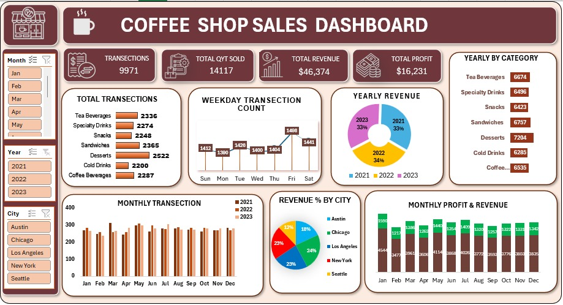

# Coffee Shop Sales Analysis using Excel

**Overview**:
This repository contains an Excel file for analyzing sales data of a coffee shop. The Excel file includes various sheets with data, charts, and analysis to help understand the performance and trends of the coffee shop's sales.

**Contents**:
1. **Data Sheet**: Contains raw sales data including date, time, item sold, quantity, and price.
2. **Summary Sheet**: Provides a summary of total sales, average sales per day, popular items, etc.
3. **Monthly Sales Analysis**: Breaks down sales data on a monthly basis with charts and graphs for visual analysis.
4. **Item Analysis**: Analyzes the performance of individual items sold in terms of quantity and revenue.
5. **Customer Analysis**: Provides insights into customer demographics, repeat purchases, etc.

**How to Use**:
1. **Download**: Download the Excel file from this repository.
2. **Data Input**: Input your own sales data into the "Data Sheet" or replace existing data.
3. **Analysis**: Navigate through different sheets to analyze various aspects of your coffee shop sales.
4. **Charts**: Charts and graphs are dynamically linked to the data. Simply update the data, and the charts will update automatically.

**Requirements** : 

Microsoft Excel 

**Contributing**:

Contributions are welcome! If you have any suggestions for improving the analysis or adding new features, feel free to fork this repository, make your changes, and submit a pull request.

**Acknowledgments**:

- Inspiration: This analysis was inspired by the need for better understanding coffee shop sales trends and performance.
- Data Source: https://mavenanalytics.io/data-playground?search=coffee 

**Feedback**:

If you have any feedback, questions, or concerns, please feel free to open an issue in this repository or contact ME at deepakm.envision@gmail.com.

Thank you for using Coffee Shop Sales Analysis Excel! Enjoy analyzing your sales data and discovering insights to improve your business.
